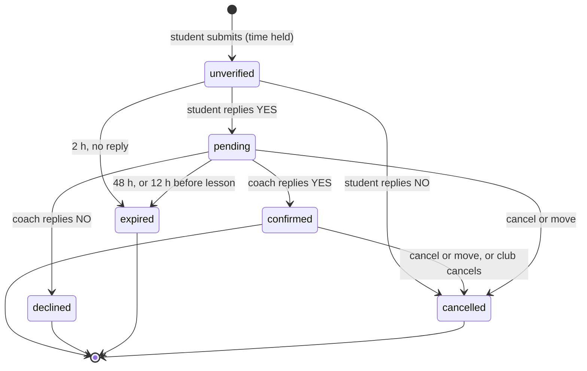

# Coaching app: where is a booking stuck?

How to find exactly which step a lesson request, a coach's times, or a change
is at, who has to act next, what they were sent, and what can go wrong. The
source of truth is the **private** Sheet (`CTTC Coaching (private - do not
share)`); the public Sheet and the booking page only show a summary. All code
references are to [`coaching-app/Code.js`](../coaching-app/Code.js).

> Keep real names, emails and phone numbers out of issues and commits when
> using this guide. Describe a case by date, time, coach first name and status.

## 1. Two-minute triage

**Start with the booking code.** Every email about a booking ends with
*Booking code: 3F09A1*, the same six characters the log uses. Ask the student
or coach for it (it is safe to share: it says nothing about the person), then
open the web app's `/exec` address with `?log=3F09A1`. It needs no sign-in and
shows that booking's lesson time, current `status`, who it is waiting on and
the deadline (`booking`), and every line about it in order (`lines`): each
step (`step:unverified`, `step:pending`, …), each email or text sent, each
YES or NO read and whether it was applied, and any failure. `runs` shows
whether the minute check and the sweep are running. Section 2 explains each
line. If that answers the question, stop here; otherwise use the private
Sheet:

1. Open the private Sheet, **Requests** tab. Find the row by `date`
   (`2026-10-16`) and `start` (`21:00`, 24-hour Pacific). A move creates a
   *new* row, so check every row for that student (`student_email`).
2. Read `status`, then check `expires_at` against now. `expires_at` is
   milliseconds since 1970 (UTC). In the Sheet, `=EPOCHTODATE(M2/1000)` gives
   the time in UTC; subtract 7 hours for PDT or 8 for PST. A waiting status
   whose `expires_at` has passed is already **expired** in the app, even
   before the hourly sweep writes it.
3. Use the table below.

| `status` | Meaning | Who must act | What they were sent | Deadline | Public board shows |
| --- | --- | --- | --- | --- | --- |
| `unverified` | Student submitted the form; nothing has gone to the coach. | **Student**: reply YES. | Email *Confirm your coaching request [CTTC ref …]*. Also a text if the student texted STUDENT earlier (`Students.texts = yes`). | 2 hours after submitting (`VERIFY_MS`), or sooner for a lesson that is close. | "Waiting for Student … to confirm" |
| `pending` | Student said YES (`verified_at` set). The coach has been asked. | **Coach**: reply YES or NO. | Coach: email *Lesson request from {student} [CTTC ref …]*, plus a text if the coach has a mobile on the list. Student: email *Coaching request sent to Coach … (not confirmed yet)*. | The earlier of 48 hours after the YES, or 12 hours before the lesson (`HOLD_HOURS`, `RELEASE_BEFORE_HOURS`). | "Waiting for Coach … to accept" |
| `confirmed` | Coach said YES. Done. | Nobody | Both: *Lesson confirmed: {date} {start}*, with each other's contact details. Texts too if opted in. | n/a | "booked" |
| `declined` | Coach said NO. | Nobody (student may pick another time) | Student: *Coaching request not accepted*. | n/a | time is open again |
| `expired` with empty `verified_at` | Student never replied YES. | Nobody | Student: *Coaching request expired: we did not get your YES*, with the steps to book again. Coach was never told. | n/a | time is open again |
| `expired` with `verified_at` set | Coach never answered. | **Club** should follow up with the coach | Student and coach both, with the club cc'd (`ADMIN_EMAIL`): *…expired: the coach did not answer* / *Lesson request expired: no answer*. | n/a | time is open again |
| `cancelled`, `cancelled_by = student` | Student replied NO to the confirm email, or confirmed a cancel. | Nobody | Student: *Coaching lesson cancelled*. Coach: *Lesson cancelled by {student}*, only if the coach had been asked (`verified_at` set). | n/a | time is open again |
| `cancelled`, `cancelled_by = move` | Student moved to another time; look for the new row (status `pending`). | See the new row | Coach of the old time: *Lesson cancelled by {student}* ("moved"). | n/a | old time open; new time "requested" |
| `cancelled`, `cancelled_by = coach` | Set by hand by the club after a coach asked to cancel (coaches reply to their confirmation email; the app does not do this itself). | Nobody | Student: *Lesson cancelled by your coach*. | n/a | time is open again |

`proposed` appears in the code's status checks but is never set; ignore it.

The booking board, schedule list, coach page and public Sheet say who owes
the next reply: **"Waiting for Student … to confirm"** (`unverified`) or
**"Waiting for Coach … to accept"** (`pending`). Before this was added (the
`/exec` release of 2026-10-10 and earlier) both showed only "requested".

## 2. Did each message actually go out?

Each person is told about each status **once**. These columns record the last
status each side was told about. They are written only after the send
succeeded, so a mismatch means the message has not gone out yet:

| Column | Holds | Example reading |
| --- | --- | --- |
| `student_emailed` | the `status` the student was last emailed about | `status = unverified`, `student_emailed` empty → **the confirm email never went out** |
| `coach_emailed` | the `status` the coach was last emailed about | `status = pending`, `coach_emailed` empty → the coach has not been emailed |
| `coach_texted` | `pending` once the coach was **asked** by text; afterwards the last status texted | `status = pending`, `coach_texted` empty → the coach has not been texted (no mobile, never texted COACH, or another question is open, see §4) |
| `student_texted` | the last status texted to the student | only for students with `Students.texts = yes` |

**Reminders.** A request still waiting gets at most one reminder per step,
sent by the sweep (hourly or after any change), so it can come a little later
than the times below and is skipped in the last 2 minutes before a deadline: the student 1 hour after asking (*Reminder: Confirm your coaching
request [CTTC ref …]*, plus a text if they get texts), and the coach 2 hours
after the student's YES (*Reminder: Lesson request from {student} [CTTC ref
…]*, plus the text question again if it is the coach's open one). At that
point the student is also emailed *Your coaching request is waiting on Coach
…*. Reminders keep the original reference code, so a reply to either email
counts. The `reminded` column (its header is added by the next sweep; no need to run
`setup()` again) holds the step (`unverified` or `pending`)
already reminded. No reminder is sent within 10 minutes of the deadline, and
the coach never hears about a request before the student's YES.

Unsent messages are retried by every sweep (hourly, and after every booking
or answer), but only while `updated_at` is under 3 days old
(`RETRY_MAIL_DAYS`) and the daily mail quota is above 10 (`MIN_QUOTA`). After
that the app gives up silently.

**Send log.** Every email and text the app sends also writes one log line,
for example `coaching sent email student_emailed:pending ref=<request_id> to=D811B0`:
the channel, the kind of message (for the sweep's status messages, the column
above and the status), the request (or coach, wait or reply) it is about, and
the recipient as a six-character code. The same person always gets the same
code, but no name, address or number is ever logged. Two lines with the same
kind, `ref` and `to` mean someone really did get the same message twice. A
minute check that starts while the previous one is still running logs
`coaching checkTexts skipped: …` and does nothing. Read the lines in the
script editor under **Executions** (open a run to see its logs).

The same lines go to the private Sheet's **Log** tab (the latest 500 are
kept), and the web app shows the latest 300 to anyone at its `/exec` address
with `?log` added, as JSON:
`{"at":"2026-10-17T19:02:11.000Z","channel":"email","kind":"student_emailed:pending","ref":"3F09A1","to":"D811B0"}`.
There `ref` is a code too, so nothing from the private Sheet is shown; lines
with the same `kind`, `ref` and `to` are the same message sent twice. It
answers 20 reads a minute. Besides messages sent (`channel` `email` or `text`),
the log holds:

- **Replies read**: kind `reply:<who>:<yes|no>` (`student-v` confirms a
  request, `student-c` a cancel or move, `coach-request`, `coach-slots`), with
  `detail` `applied, now confirmed` or `not applied, now expired`.
- **Failures**: `channel` `error`, kind naming what failed (for example
  `send-coach_emailed:pending`, `read-coach-texts`), and `detail` the error
  with addresses, numbers, quoted text and long ids replaced. The same failure
  is logged at most every 10 minutes.
- **Steps**: `channel` `step`, kind `step:<status>` each time a booking
  changes status (made, confirmed by the student, accepted, declined,
  cancelled, moved, expired), with `detail` saying who must act next and by
  when (`waiting on coach until Saturday, October 10, 2026, 3:00 PM Pacific
  Time`), who cancelled (`by student`), or for a move, `moved from <old code>`.
- **Skipped minute checks**: kind `check-skipped`.

`?log=<code>` shows only that booking's lines, plus a `booking` summary
(`code`, `date`, `start`, `status`, `waitingOn`, `deadline`) from the private
Sheet; it finds bookings made in the last 60 days. The log keeps the latest
500 lines, so an older booking's early lines may be gone.

Above the lines, `runs` shows the last minute check and the last sweep: when
they finished, `ok`, and which steps failed; the minute check also has
`mail`, the same counts as the status read-out below. A `checkTexts` time more than a
few minutes old means the minute trigger has stopped.

## 3. The request lifecycle

A change (cancel or move) does **not** change `status` until the student
confirms. While it waits, the row has `change = cancel` or
`change = move:{avail_id}` and `change_at` (ms). The student is emailed
*Confirm: cancel your lesson [CTTC ref …]* or *Confirm: move your lesson
[CTTC ref …]*. A move is applied only if the new time is still open when they
reply YES; the new row starts at `pending` (the coach is asked straight away).

## 4. How replies are recognised (the usual place things stick)

Answers are read by the `checkTexts` trigger, which runs every minute.

**Email replies** (`checkMail_`) count only if **all** of these hold:

- the reply's subject still contains the `[CTTC ref XXXXXXXXXX]` code (a normal
  "Reply" keeps it; editing the subject or writing a new email loses it);
- it comes **from the address the question went to** (case, and for Gmail
  dots and `+tags`, do not matter). A reply from another account, alias or
  relay address (for example Apple's *Hide My Email*) does not count, but the
  sender is told to reply from the right address (the club is not emailed);
- the **first line of the person's own words starts with yes or no**, in any
  case, optionally after a greeting or `ok` (`Yes, see you Friday`, `ok yes`,
  `Hi Dee, yes`, `no thanks`, `y`, `yep`, `nope`); a greeting on its own line
  (`Hi John,` then `Yes`) is skipped. A yes or no further in (`there is no
  parking`, an out-of-office note) is not an answer, nor is a line with both
  (`Yes, but I can't make it`). Automatic replies are skipped. The quoted
  earlier message (`On … wrote:`, `>` lines, `-------- Original message
  --------`, an Outlook `From:` block, our own `Reply YES`/`[CTTC ref`
  lines) and signatures (`Sent from my …`, `-- `) are cut off, even when an
  HTML-only reply arrives with lines run together (`YESSent from my
  Galaxy`): when an email has an HTML version, its own line breaks are used.
Invisible characters are removed first. An unreadable reply to an
  open question gets one "please reply again" email (the club is not emailed);
- it arrives within 3 days and after the question was asked, and the
  question is still open.

**Text replies** go through the club's Google Voice number, forwarded to Gmail:

- The app can only text someone who has **texted the club number first**:
  coaches text `COACH` once (this sets `Coaches.registered_at`), students text
  `STUDENT` (sets `Students.texts = yes`, `texts_at`).
- The sender is matched by the mobile number on the list, or by the Google
  Voice contact name matching the name on the list.
- Each person has **one open question at a time** (`ask_ref`, `ask_at` on the
  Coaches or Students row). A bare YES answers that one question. Coaches:
  `ask_ref` is `slots` or a `request_id`; students: `v:{request_id}`
  (confirm) or `c:{request_id}` (change). Other pending requests are texted
  after the open one is answered; a fresh request replaces an open question
  only after 10 minutes (`PROPOSE_WAIT_MS`).

An email reply to an open question that cannot be used gets an explanation
(unreadable, or wrong address) within about 5 hours of arriving; the club is
not emailed. Text replies with no yes/no are still ignored without a message.
Each step of the minute check runs on its own, so a failing step (for
example Google Voice) does not stop email answers being read. A step that
fails at every attempt for 30 minutes (`ALERT_AFTER_MS`) is emailed to the club
once, as *Action needed: the coaching app cannot …*, with what to do; when it
works again the club gets *Resolved: the coaching app can … again*. A failure
that clears sooner (Google outages of a few minutes are common) is logged, not
emailed. A student's YES sent
before the deadline but read after it still counts if the lesson is still
offered, free, at least about an hour from its own deadline, and the coach
is active.

**Status read-out.** After each minute check the app renames a separate,
empty spreadsheet in the club's Drive (recreated if deleted), *CTTC Coaching
status | {time, rounded down to 10 minutes} | mail
q=… late=… threads=… messages=… coded=… answers=… | failed: …*. It holds
counts only: open email questions, late-YES look-backs, threads and messages
read, replies quoting a code, answers applied, unreadable replies (with the
length of the first line and any invisible or unusual space characters in it,
as code points; never letters), and failed steps (addresses, numbers and
quoted text masked). If
it is not updating, the minute check is not running.

## 5. Coaches' offered times

| Where | What it tells you |
| --- | --- |
| **Coaches** `ask_slots` (JSON) and `ask_made` (ms) | The coach submitted times on the page and we are waiting for their YES (email *Confirm your coaching times [CTTC ref …]* and/or a text). Nothing is published until then. The email and text say when the coach must reply by: 48 hours after sending (`ASK_TTL_MS`). A lapsed list is kept another 14 days (`LATE_ASK_MS`) so a late reply is answered, never ignored (below). |
| **Coaches** `registered_at` | The coach's texts work (they texted the club number). Empty means texting them fails. |
| **Coaches** `status = disabled` | The coach and all their times are hidden. The hourly sweep sets this for anyone not in `CLUB_COACHES` in `coaching-app/Code.js` and clears it for anyone who is, so add or remove a coach there (and in the table on `coaching.html`), not in the Sheet. |
| **Availability** rows with `confirmed = yes` | Published times. A row is one slot: `minutes` 30 or 60, `table` 1 to 3. A 25-minute booking on a 60-minute slot splits it into two 30-minute rows. Past rows are deleted by the sweep. |
| **Waitlist** | People emailed (*A coaching time you wanted is open*) when a held time frees up; each is removed once told. |

**A late reply to a list** (after its 48 hours, within 14 more days), by email or text:

- **YES, and every time is still free:** the coach is told the reply came after
  the 48-hour window and that the times are all still open, and the same list
  is sent again with a new 48 hours (*Confirm your coaching times [CTTC ref …]*,
  with a new reference). One more YES publishes it.
- **YES, but another coach has since taken one of the times:** the coach is
  told which times were taken (and which were still open), that nothing was
  published, and to pick their times again on the coaching page (*Your
  coaching times were not published*).
- **NO:** the coach is told nothing changed.

Each is logged as `reply:coach-slots:yes` or `:no` with `not applied, now late,
offered again`, `late, taken` or `late, no`.

Students can only request times that are confirmed, **at least 24 hours away**
(`LEAD_HOURS`) and **at most 28 days ahead** (`HORIZON_DAYS`), on Fridays 7 to
10 PM or Saturdays 3 to 6 PM Pacific.

## 6. How the website shows the app

The **Coaching** page's button opens the site's own copy of the page,
`coaching-app.html`, which the deploy workflow publishes from
`coaching-app/Index.html`. That copy calls the app at
`https://script.google.com/macros/s/AKfycbywI5OV0aaitPbzchxfyJUK4Q6_uLbFpF39O_cq8fLikbSO5Sy_NW3B3R-NlPtTS2YdTw/exec`
(`API_URL` in `Index.html`) with `fetch` and **no cookies** (`doPost`, which
answers only the page's seven calls). Nobody needs a Google account, and a
browser signed in to several Google accounts cannot trip Google's "Sorry,
unable to open the file at this time" page. Until 2026-10-22 the button framed
Google's page host directly, and some members got that page instead of the
app. The same page still works served by Google at that address (with
`google.script.run`).

If the copy's first call gets no answer from the app (for example the site was
deployed before the `/exec` release that added `doPost`), the copy hands over to
Google's own page, as the button worked before. A change to `Index.html`
reaches the website with the next site deploy (any push to `main`), and a change
to `Code.js` with the usual `/exec` release.

| Symptom | Check |
| --- | --- |
| A member sees "Sorry, unable to open the file at this time" | The copy handed over to Google's page: the `/exec` release with `doPost` is not out yet, or the app did not answer. Open `/exec?log` to see whether the app runs. |
| The page stays on "Loading" | Open `concordtabletennisclub.com/coaching-app.html` directly; a blank page or a console error points at the page, a "Something went wrong" message at the app. |

## 7. What the page said, and what it means

Each form shows its answer right under its own Send button (and at the top of the page), scrolls to it, and outlines and
focuses the field to fix. Before 2026-10-10 errors appeared only at the top of the page, which on a phone is usually off
screen, so a refused request looked like nothing happened.

| Message on the page | What happened |
| --- | --- |
| "Almost done: we emailed you… Reply YES… within 2 hours" | Saved as `unverified`. Waiting for the student. |
| "That time is no longer available. Please pick another." | Someone holds that time, **including the same student's own earlier request**. Look for an existing row before assuming a bug. |
| "Please enter the parent or guardian's name…" / "Please check the parent or guardian name…" | "The student is under 18" is ticked and the guardian name is blank, or has numbers or symbols. Names may use letters, spaces and `- ' . , & / ( )`. |
| "You already have 2 requests waiting for an answer." | The student has 2 `unverified`/`pending` rows (`MAX_OPEN_REQUESTS_PER_STUDENT`). |
| "Too many requests right now." | More than 30 calls in a minute across the whole app (`MAX_PER_MINUTE`). |
| "Requests are closed for now." | The Requests or Students tab hit its size cap (`MAX_REQUESTS`, `MAX_STUDENTS`). |
| "Something went wrong. Please try again." | The server threw an error (the page never shows the real message). Look in the Apps Script editor, **Executions**, for a failed `requestSlot`, `studentChange` etc. **Before the fix in this branch** a request could be saved and still show this (see §8). |

## 8. Known failure modes

| Symptom | Likely cause | Check | Fix |
| --- | --- | --- | --- |
| Page said "Something went wrong", retries say the time is taken, but a "requested" row exists for the student | Before `fix(coaching): never report a saved lesson request as a failure`, an error *after* saving (email, text, public Sheet rebuild) was shown as a failure. | Row is `unverified`; `student_emailed` may be empty. Executions show a failed `requestSlot`. | Fixed in code. For the stuck case, the next sweep sends the confirm email if it has not gone out. The student replies YES before `expires_at`. |
| Student says they replied YES but row is still `unverified` | Reply not recognised (§4): different address, edited subject, a first line that does not start with yes, or too late. Check the status read-out for `unreadable=`. | Find the reply in the club Gmail. | Ask them to reply to the original email with just `YES`, or have them submit again after it expires. |
| Row is `pending` for a long time | Coach has not answered, or their answer was not recognised (§4). | `coach_emailed = pending`? `coach_texted = pending`? `Coaches.ask_ref` = this `request_id`? | Remind the coach to reply `YES` to the email or text. |
| Coach never gets texts | They never texted the club number, or the Voice contact name/number does not match the list. | `Coaches.registered_at` empty; `phone` column. | Have them text `COACH` to the club number. |
| No emails at all for a while | Daily mail quota low (sending pauses at 10 left), or Gmail/MailApp errors. | Executions log; `student_emailed`/`coach_emailed` lagging behind `status`. | Wait for the quota reset; the sweep retries for 3 days. |
| Time shows "closed" | It is under 24 hours away, so it no longer takes requests. Expected. | `date`/`start`. | None in the app. |
| Public Sheet out of date | It is rebuilt only after changes and hourly; a failed rebuild is logged, never fatal. | Executions log for "Could not update the public schedule". | Run `sweep` from the editor. |

## 9. Timing reference

| Constant | Value | Effect |
| --- | --- | --- |
| `VERIFY_MS` | 2 hours | time for the student's YES |
| `HOLD_HOURS` | 48 hours | max time for the coach's YES |
| `RELEASE_BEFORE_HOURS` | 12 hours | a waiting request expires this long before the lesson |
| `LEAD_HOURS` | 24 hours | no new requests closer than this |
| `HORIZON_DAYS` | 28 days | how far ahead times can be offered or requested |
| `ASK_TTL_MS` | 24 hours | a coach's submitted list of times lapses |
| `CHANGE_WAIT_MS` | 10 minutes | gap between cancel/move requests for one lesson |
| `REMIND_STUDENT_MS`, `REMIND_COACH_MS` | 1 hour, 2 hours | when the one reminder for each waiting step goes out |
| `RETRY_MAIL_DAYS` | 3 days | unsent messages are retried this long |
| Triggers | `checkTexts` every minute, `sweep` hourly | replies are picked up within about a minute |
