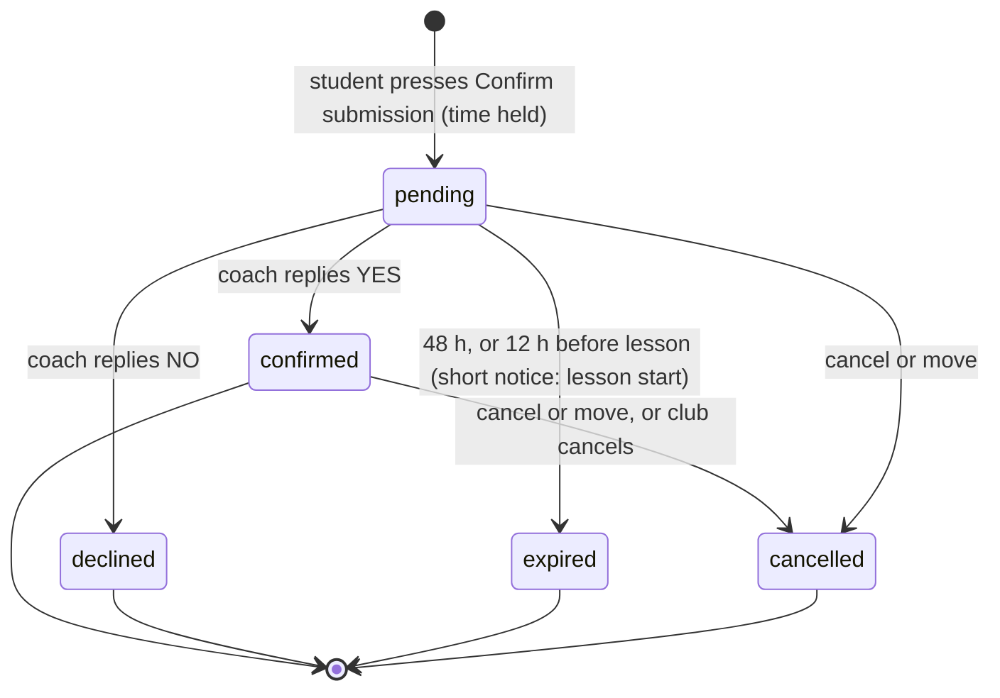

# Coaching app: where is a booking stuck?

How to find exactly which step a lesson request, a coach's times, or a change
is at, who has to act next, what they were sent, and what can go wrong. The
source of truth is the **private** Sheet (`CTTC Coaching (private - do not
share)`); the public Sheet and the booking page only show a summary. All code
references are to [`coaching-app/Code.js`](../coaching-app/Code.js).

> Keep real names, emails and phone numbers out of issues and commits when
> using this guide. Describe a case by date, time, coach first name and status.

## 1. Two-minute triage

**Start with the booking code.** Every email about a booking ends with
*Booking code: 3F09A1*, the same six characters the log uses. Ask the student
or coach for it (it is safe to share: it says nothing about the person), then
open the web app's `/exec` address with `?log=3F09A1`. It needs no sign-in and
shows that booking's lesson time, current `status`, who it is waiting on and
the deadline (`booking`), and every line about it in order (`lines`): each
step (`step:pending`, `step:confirmed`, …), each email or text sent, each
YES or NO read and whether it was applied, and any failure. `runs` shows
whether the check and the sweep are running. Section 2 explains each
line. If that answers the question, stop here; otherwise use the private
Sheet:

1. Open the private Sheet, **Requests** tab. Find the row by `date`
   (`2026-10-16`) and `start` (`21:00`, 24-hour Pacific). A move creates a
   *new* row, so check every row for that student (`student_email`).
2. Read `status`, then check `expires_at` against now. `expires_at` is
   milliseconds since 1970 (UTC). In the Sheet, `=EPOCHTODATE(M2/1000)` gives
   the time in UTC; subtract 7 hours for PDT or 8 for PST. A waiting status
   whose `expires_at` has passed is already **expired** in the app, even
   before the hourly sweep writes it.
3. Use the table below.

| `status` | Meaning | Who must act | What they were sent | Deadline | Public board shows |
| --- | --- | --- | --- | --- | --- |
| `pending` | Student pressed **Confirm submission** on the page; the coach has been asked (`verified_at` is that moment). | **Coach**: reply YES or NO. | Coach: email *Lesson request from {student} [CTTC ref …]* with the student's name, email and mobile (if given), plus a text if the coach has a mobile on the list. Student: email *Coaching request sent to Coach … (not confirmed yet)*. | The earlier of 48 hours after the request, or 12 hours before the lesson (`HOLD_HOURS`, `RELEASE_BEFORE_HOURS`). When that leaves the coach under 2 hours (`MIN_ANSWER_MS`, a lesson booked at short notice), until the lesson starts. | "Waiting for Coach … to accept" |
| `unverified` | Only a request made before November 2026, when the student had to reply YES first. Nothing new is ever saved this way. | **Student**: reply YES. | Email *Confirm your coaching request [CTTC ref …]*. | 2 hours after submitting. | "Waiting for Student … to confirm" |
| `confirmed` | Coach said YES. Done. | Nobody | Both: *Lesson confirmed: {date} {start}*, with each other's contact details. Texts too if opted in. | n/a | "booked" |
| `declined` | Coach said NO. | Nobody (student may pick another time) | Student: *Coaching request not accepted*. | n/a | time is open again |
| `expired` with empty `verified_at` | (Before November 2026 only.) Student never replied YES. | Nobody | Student: *Coaching request expired: we did not get your YES*, with how to book now. Coach was never told. | n/a | time is open again |
| `expired` with `verified_at` set | Coach never answered. | **Club** should follow up with the coach | Student and coach both, with the club cc'd (`ADMIN_EMAIL`): *…expired: the coach did not answer* / *Lesson request expired: no answer*. | n/a | time is open again |
| `cancelled`, `cancelled_by = student` | Student confirmed a cancel (or, before November 2026, replied NO to the confirm email). | Nobody | Student: *Coaching lesson cancelled*. Coach: *Lesson cancelled by {student}*, only if the coach had been asked (`verified_at` set). | n/a | time is open again |
| `cancelled`, `cancelled_by = move` | Student moved to another time; look for the new row (status `pending`). | See the new row | Coach of the old time: *Lesson cancelled by {student}* ("moved"). | n/a | old time open; new time "requested" |
| `cancelled`, `cancelled_by = coach` | Set by hand by the club after a coach asked to cancel (coaches reply to their confirmation email; the app does not do this itself). | Nobody | Student: *Lesson cancelled by your coach*. | n/a | time is open again |

`proposed` appears in the code's status checks but is never set; ignore it.

The booking board, schedule list, coach page and public Sheet say who owes
the next reply: **"Waiting for Coach … to accept"** (`pending`), or, for a
request from before November 2026, **"Waiting for Student … to confirm"**
(`unverified`). Before this was added (the `/exec` release of 2026-10-10 and
earlier) both showed only "requested".

**How a request is made (from November 2026).** The student picks a time
that has not started yet (Pacific time), fills in the form and presses **Send
request**. The page then shows a confirm box: the lesson, the coach, the
address we will email under *We will email the coach's answer to:* in large
bold type, and every other detail the coach will get (student, parent if under
18, mobile), with *Clicking Confirm submission sends a message to Coach … to
confirm the lesson and gives Coach … your contact information: the email
address above and these details*. Tapping the address (**✎ Edit**) corrects it
right in the box, and the correction goes back into the form.
**Confirm submission** sends it; **Go back** (or Esc) sends nothing. The
request is saved as `pending` and the coach is asked at once. There is no
emailed or texted YES from the student for a new request, and no student
reminder. The emailed YES is still how a student confirms a **cancel or move**.
Before November 2026 a new request waited up to 2 hours for the student's
emailed YES (`unverified`); a request still waiting when the change was
released finishes the old way (its YES still counts; it is not reminded).

**A likely typo in the email address (from November 2026).** When the student
leaves the email box (Tab, or a tap elsewhere), the page checks the part after
the `@` against common providers and shows *Did you mean …?* with **Use …**
and **Keep mine** under the box (`emailTypo` in `coaching-app/Index.html`). A
clear slip (one letter off a big provider such as `gmial.com`, a made-up ending
such as `.con`, `gmail.co`, `.com.com`) is amber; an address worth a look
(`comcast.com`, `hotmail.co`) gets a quieter hint that says why. A student who
presses **Send request** straight after typing sees no hint on the form (the
button would move under their finger); a clear slip is pointed out again in
the confirm box, where one tap fixes it, and a softer one is not. Editing the
address in the confirm box runs the same check. It is only a suggestion: the
student can always keep what they typed, and the server's own check of the
address is unchanged. Real providers next to a big one (`mail.com`,
`email.com`, `gmx.com`, `ymail.com`) and country endings (`hotmail.fr`) are
never flagged.

## 2. Did each message actually go out?

Each person is told about each status **once**. These columns record the last
status each side was told about. They are written only after the send
succeeded, so a mismatch means the message has not gone out yet:

| Column | Holds | Example reading |
| --- | --- | --- |
| `student_emailed` | the `status` the student was last emailed about | `status = unverified`, `student_emailed` empty → **the confirm email never went out** |
| `coach_emailed` | the `status` the coach was last emailed about | `status = pending`, `coach_emailed` empty → the coach has not been emailed |
| `coach_texted` | `pending` once the coach was **asked** by text; afterwards the last status texted | `status = pending`, `coach_texted` empty → the coach has not been texted (no mobile, never texted COACH, or another question is open, see §4) |
| `student_texted` | the last status texted to the student | only for students with `Students.texts = yes` |

**Reminders.** A request still waiting on the coach gets one reminder, sent
by the sweep (hourly or after any change), so it can come a little later than
due and is skipped in the last 2 minutes before the deadline: the coach 2
hours after the request, or halfway to the deadline when that is sooner (a
lesson booked at short notice): *Reminder: Lesson request from {student}
[CTTC ref …]*, plus the text question again if it is the coach's open one.
At that point the student is also emailed *Your coaching request is waiting
on Coach …*, saying nothing more is needed from them. The reminder keeps the
original reference code, so a reply to either email counts. The `reminded`
column holds the step already reminded (`pending`). Students are never
reminded: no new request waits for them (a cancel or move they asked for is
not reminded either).

Unsent messages are retried by every sweep (hourly, and after every booking
or answer), but only while `updated_at` is under 3 days old
(`RETRY_MAIL_DAYS`) and the daily mail quota is above 10 (`MIN_QUOTA`). After
that the app gives up silently.

**Send log.** Every email and text the app sends also writes one log line,
for example `coaching sent email student_emailed:pending ref=<request_id> to=D811B0`:
the channel, the kind of message (for the sweep's status messages, the column
above and the status), the request (or coach, wait or reply) it is about, and
the recipient as a six-character code. The same person always gets the same
code, but no name, address or number is ever logged. Two lines with the same
kind, `ref` and `to` mean someone really did get the same message twice. A
check that starts while the previous one is still running logs
`coaching checkTexts skipped: …` and does nothing. Read the lines in the
script editor under **Executions** (open a run to see its logs).

The same lines go to the private Sheet's **Log** tab (the latest 500 are
kept), and the web app shows the latest 300 to anyone at its `/exec` address
with `?log` added, as JSON:
`{"at":"2026-10-17T19:02:11.000Z","channel":"email","kind":"student_emailed:pending","ref":"3F09A1","to":"D811B0"}`.
There `ref` is a code too, so nothing from the private Sheet is shown; lines
with the same `kind`, `ref` and `to` are the same message sent twice. It
answers 20 reads a minute. Besides messages sent (`channel` `email` or `text`),
the log holds:

- **Replies read**: kind `reply:<who>:<yes|no>` (`student-v` confirms a
  request, `student-c` a cancel or move, `coach-request`, `coach-slots`), with
  `detail` `applied, now confirmed` or `not applied, now expired`.
- **Failures**: `channel` `error`, kind naming what failed (for example
  `send-coach_emailed:pending`, `read-coach-texts`), and `detail` the error
  with addresses, numbers, quoted text and long ids replaced. The same failure
  is logged at most every 10 minutes.
- **Steps**: `channel` `step`, kind `step:<status>` each time a booking
  changes status (made, confirmed by the student, accepted, declined,
  cancelled, moved, expired), with `detail` saying who must act next and by
  when (`waiting on coach until Saturday, October 10, 2026, 3:00 PM Pacific
  Time`), who cancelled (`by student`), or for a move, `moved from <old code>`.
- **Skipped checks**: kind `check-skipped`.

`?log=<code>` shows only that booking's lines, plus a `booking` summary
(`code`, `date`, `start`, `status`, `waitingOn`, `deadline`) from the private
Sheet; it finds bookings made in the last 60 days. The log keeps the latest
500 lines, so an older booking's early lines may be gone.

Above the lines, `runs` shows the last check and the last sweep: when they
finished, `ok`, and which steps failed; the check also has `mail`, the same
counts as the status read-out below. The check runs at least hourly (with the
sweep), so a `checkTexts` time more than about an hour old means the hourly
`sweep` timer has stopped.

## 3. The request lifecycle

(A request from before November 2026 started as `unverified` and became
`pending` on the student's YES, `cancelled` on NO, or `expired` after 2
hours.)

A change (cancel or move) does **not** change `status` until the student
confirms. While it waits, the row has `change = cancel` or
`change = move:{avail_id}` and `change_at` (ms). The student is emailed
*Confirm: cancel your lesson [CTTC ref …]* or *Confirm: move your lesson
[CTTC ref …]*. A move is applied only if the new time is still open when they
reply YES; the new row starts at `pending` (the coach is asked straight away).

While a cancel or move waits, the booking page, the coach page and the public
Sheet show it on the lesson: **"Cancel requested: waiting for Student … to
confirm"** (or "Move requested: …"). The lesson still counts as booked until
the student's YES.

### Everything waiting, in one email

A student can have several things waiting for their YES at one address: cancels
or moves of different lessons (and, before November 2026, a new request), each
asked by its own email.
People answer the newest email and expect that to be the answer. On 3 November
2026 a student asked to cancel two Friday lessons, then booked a Saturday one
and replied YES to that email; the two cancellations kept waiting. So **every
email to a student while more than one thing waits for them lists them all**,
numbered, under one new reference code, before the email's own details:

| Answer (each is a button) | What it does |
| --- | --- |
| **YES** | Every item listed. |
| **YES to ONLY THIS** | Only the item the email was sent about (marked *THIS EMAIL*); the rest stay waiting. |
| **NO** | Declines only that item (drops that request, or keeps that lesson); the rest stay waiting. |

A button opens a new email to the club with the subject (so the code) and the
answer already written; the student presses Send. Replying with the word works
the same. An email that asks nothing of its own (*Lesson confirmed*, *Coaching
request sent to …*, a reply to an answer) lists what is still waiting with
**YES** only, and its subject gets a code. With only one thing waiting, the
email is as before (YES and NO), with buttons. Earlier emails keep answering
their own item.

- What each list held is the private **Bundles** tab: `trigger` (the item that
  email was about, empty for a follow-up) and `items` (`v:{request_id}` for a
  new request, `c:{request_id}:{change_at}` for a cancel or move). A YES does
  exactly what was listed, never something asked later. The sweep drops a list
  once nothing on it waits.
- Read as **only**: `YES to ONLY THIS`, `yes, only this one`, `yes just this`,
  `only this`, `yes to only this, not the others`. To a list, any other yes
  that says *only*, *except* or *but* (`yes, only the Saturday one`) is
  unclear: nothing changes and the student gets *We could not read your
  reply*. `yes to all` and `yes, both` are a yes.
- In the log: `reply:student-b:yes` (or `:only`, `:no`) with `detail`
  `listed 3, done 3`, then one `reply:student-v` or `reply:student-c` line per
  item it did. Anything that could not be done (a new time was taken, a
  request expired) is explained in one *Your coaching reply* email.
- Texts are unchanged: a texted YES answers the one question last texted.

**One time, 4 November 2026.** At the owner's request the sweep counted that
student's Saturday YES for her two waiting cancellations (booking codes
9E3D15 and 32AF8F, from the YES to 367613), as this would have. It ran once
(script property `ONE_TIME_YES_TO_ALL_367613`) and logged each step as
`one-time-yes-to-all`.

### The owner's daily summary

The first hourly sweep after 7 AM Pacific emails the owner (the script
property `SUMMARY_EMAIL`, else `SUMMARY_TO` in `Code.js`) *Coaching daily
summary: N waiting for a YES, M confirmed yesterday*:

- **Waiting on students:** each new request to confirm and each cancel or move
  to confirm, with the student, coach, lesson time, booking code and how long it
  has waited. **Waiting on coaches:** each request to accept and each list of
  times to publish. *Nothing is waiting for an emailed YES* when there is none.
- **Yesterday** (the Pacific day), counted from the Log tab: YES answers
  applied (lessons accepted by coaches, cancels and moves, coaching times, and
  any request from before November 2026 a student confirmed); **new requests**
  sent to the coach from the page (`step:pending` lines with *booked on the
  page*; these are not YES answers, so they are not in the *confirmed*
  total); **no answer**, requests that expired without the coach's answer
  (`step:expired` lines with *coach did not answer*); NO answers applied; and
  replies to an email listing several things. The Log keeps the latest 500
  lines; if it does not reach back to the start of yesterday, the email says
  the counts may be low.

  Before November 2026 every new request also counted as a YES (the student's),
  so *confirmed yesterday* in the subject reads lower from then on for the
  same number of lessons; compare *New requests* and *Lessons* instead.

- **Volunteers**, from the volunteer app's hidden `StaffingDigest` tab in the
  desk Sheet ([staffing flow](staffing-flow.md), *The owner's daily summary*):
  sign-ups and drops waiting for a volunteer's YES, emails waiting for the
  club's approval, anyone with several things waiting, and yesterday's counts.
  If that app has not written the tab for 2 hours, the email says so.

The subject is *CTTC daily summary: N waiting for a YES, M confirmed
yesterday*, counting both apps. It is sent once a day (`SUMMARY_SENT` holds
the day) and logged as `daily-summary`.

### When a newer ask replaces an older one

A request for a time that overlaps a lesson or request the **same student**
already holds (same email and name, another coach or table) is refused on the
page: *Student … already has a lesson at that time: … To change it, tap that
time on the schedule and choose Move it to another time.* Since a new request
no longer waits for a YES, letting it replace the older one would cancel a
lesson nobody confirmed cancelling. Another student booked from the same
address (a brother or sister) can still take the other table.

A student who asks again about the same lesson (a cancel, then a move) means
the newer ask. It replaces the older one, never anyone else's, but only once
they say YES to it; until then nothing changes and both are held. (Before
November 2026 an overlapping new request could also replace a lesson, on the
same terms; one still waiting when that changed finishes that way.) The newer email shows the change the way the desk shows a player
edit: *This replaces your earlier request: ~~Cancel it~~ → **Move it to …***
(in a list, the item is marked CHANGE). The older question stops counting: a
reply to it gets *you have since replaced that request … nothing changed* and
lists the newer one (`reply:student-r:…`, `not applied, replaced`). The YES to
an overlapping request cancels the one it replaces (`step:cancelled`, `by
student, replaced by {code}`); its coach is told as for any cancellation. A
second change of the same lesson takes the place of the first at once (the
lesson itself is untouched until the YES); `change_was` keeps what it
replaced, so the older email's code is still recognised.

## 4. How replies are recognised (the usual place things stick)

Answers are read by the check (`checkTexts`). It has no timer of its own,
because timer run time is shared by every club app
([Google limits](google-limits.md)) and a check that finds nothing still
counts. Instead the desk's one mail reader **wakes** it whenever a text or an
email reply to one of its questions comes in (within about 5 minutes by day, a
minute during round robin sign-up, 30 at night;
[Waking the apps](round-robin-operations.md#waking-the-coaching-and-staffing-apps)).
The wake calls the app's `/exec` address, which counts as a web request, not
timer time. The app looks only when what came in can matter: a YES or NO,
STUDENT or STOP, any text from a coach waiting to be verified, or an email
reply; a round robin sign-up text is answered "nothing to check" at once. The
hourly `sweep` runs the check too, so nothing waits more than an hour if a
wake is missed.

**Email replies** (`checkMail_`) count only if **all** of these hold:

- the reply's subject still contains the `[CTTC ref XXXXXXXXXX]` code (a normal
  "Reply" keeps it; editing the subject or writing a new email loses it);
- it comes **from the address the question went to** (case, and for Gmail
  dots and `+tags`, do not matter). A reply from another account, alias or
  relay address (for example Apple's *Hide My Email*) does not count, but the
  sender is told to reply from the right address (the club is not emailed);
- the **first line of the person's own words starts with yes or no**, in any
  case, optionally after a greeting or `ok` (`Yes, see you Friday`, `ok yes`,
  `Hi Dee, yes`, `no thanks`, `y`, `yep`, `nope`); a greeting on its own line
  (`Hi John,` then `Yes`) is skipped. A yes or no further in (`there is no
  parking`, an out-of-office note) is not an answer, nor is a line with both
  (`Yes, but I can't make it`). Automatic replies are skipped. The quoted
  earlier message (`On … wrote:`, `>` lines, `-------- Original message
  --------`, an Outlook `From:` block, our own `Reply YES`/`[CTTC ref`
  lines) and signatures (`Sent from my …`, `-- `) are cut off, even when an
  HTML-only reply arrives with lines run together (`YESSent from my
  Galaxy`): when an email has an HTML version, its own line breaks are used.
Invisible characters are removed first. An unreadable reply to an
  open question gets one "please reply again" email (the club is not emailed);
- it arrives within 3 days and after the question was asked, and the
  question is still open.

**Text replies** go through the club's Google Voice number, forwarded to Gmail.
The app reads texts from the desk Sheet's `VoiceTexts` tab, where the desk's one
mail reader collects them (every minute in the last 4 hours of round robin sign-up, every 5 minutes otherwise by day, every 30 overnight; [One Gmail reader](round-robin-operations.md#one-gmail-reader)),
so set the script property `DESK_SHEET_ID` to the desk Sheet's id. It searches
Gmail for texts only to text back someone whose last text came before the desk
started collecting them. Emailed answers are searched from the last check (5
minutes back), not from the oldest open question.

- The app can only text someone who has **texted the club number first**:
  coaches text `COACH` once (this sets `Coaches.registered_at`), students text
  `STUDENT` (sets `Students.texts = yes`, `texts_at`).
- The sender is matched by the mobile number on the list, or by the Google
  Voice contact name matching the name on the list.
- Each person has **one open question at a time** (`ask_ref`, `ask_at` on the
  Coaches or Students row). A bare YES answers that one question. Coaches:
  `ask_ref` is `slots` or a `request_id`; students: `v:{request_id}`
  (confirm) or `c:{request_id}` (change). Other pending requests are texted
  after the open one is answered; a fresh request replaces an open question
  only after 10 minutes (`PROPOSE_WAIT_MS`).

An email reply to an open question that cannot be used gets an explanation
(unreadable, or wrong address) within about 5 hours of arriving; the club is
not emailed. Text replies with no yes/no are still ignored without a message.
Each step of the check runs on its own, so a failing step (for
example Google Voice) does not stop email answers being read. A step that
fails at every attempt for 30 minutes (`ALERT_AFTER_MS`) is emailed to the club
once, as *Action needed: the coaching app cannot …*, with what to do; when it
works again the club gets *Resolved: the coaching app can … again*. A failure
that clears sooner (Google outages of a few minutes are common) is logged, not
emailed. A student's YES sent
before the deadline but read after it still counts if the lesson is still
offered, free, at least about an hour from its own deadline, and the coach
is active.

**Status read-out.** After each check the app renames a separate,
empty spreadsheet in the club's Drive (recreated if deleted), *CTTC Coaching
status | {time, rounded down to 10 minutes} | mail
q=… late=… threads=… messages=… coded=… answers=… | failed: …*. It holds
counts only: open email questions, late-YES look-backs, threads and messages
read, replies quoting a code, answers applied, unreadable replies (with the
length of the first line and any invisible or unusual space characters in it,
as code points; never letters), and failed steps (addresses, numbers and
quoted text masked). If
it has not changed for more than an hour, the check is not running.

## 5. Coaches' offered times

| Where | What it tells you |
| --- | --- |
| **Coaches** `ask_slots` (JSON) and `ask_made` (ms) | The coach submitted times on the page and we are waiting for their YES (email *Confirm your coaching times [CTTC ref …]* and/or a text). Nothing is published until then. The email and text say when the coach must reply by: 48 hours after sending (`ASK_TTL_MS`). A lapsed list is kept another 14 days (`LATE_ASK_MS`) so a late reply is answered, never ignored (below). |
| **Coaches** `registered_at` | The coach's texts work (they texted the club number). Empty means texting them fails. |
| **Coaches** `status = disabled` | The coach and all their times are hidden. The hourly sweep sets this for anyone not in `CLUB_COACHES` in `coaching-app/Code.js`, and for a club coach the coaching page does not show (Pending at USATT and not one of the owner's `showWhilePending` exceptions in `data/coach-certifications.json`). It clears it for a club coach the page shows. The desk copies who is shown from the site to the hidden `CoachList` tab of its Sheet every hour; until that tab exists, or when it cannot be read, club coaches stay as they are. Add or remove a coach in `CLUB_COACHES` and the table on `coaching.html`, not in the Sheet. |
| **Availability** rows with `confirmed = yes` | Published times. A row is one slot: `minutes` 30 or 60, `table` 1 to 3. A 25-minute booking on a 60-minute slot splits it into two 30-minute rows. Past rows are deleted by the sweep. |
| **Waitlist** | People emailed (*A coaching time you wanted is open*) when a held time frees up; each is removed once told. |

**A late reply to a list** (after its 48 hours, within 14 more days), by email or text:

- **YES, and every time is still free:** the coach is told the reply came after
  the 48-hour window and that the times are all still open, and the same list
  is sent again with a new 48 hours (*Confirm your coaching times [CTTC ref …]*,
  with a new reference). One more YES publishes it.
- **YES, but another coach has since taken one of the times:** the coach is
  told which times were taken (and which were still open), that nothing was
  published, and to pick their times again on the coaching page (*Your
  coaching times were not published*).
- **NO:** the coach is told nothing changed.

Each is logged as `reply:coach-slots:yes` or `:no` with `not applied, now late,
offered again`, `late, taken` or `late, no`.

Students can only request times that are confirmed, **have not started yet**
(Pacific time; until November 2026 they had to be at least 24 hours away) and
are **at most 28 days ahead** (`HORIZON_DAYS`), on Fridays 7 to 10 PM or
Saturdays 3 to 6 PM Pacific. Emails ask students to cancel or move at least 24
hours ahead when they can (`CANCEL_NOTICE_HOURS`); that is not enforced.

## 6. How the website shows the app

The **Coaching** page's button opens the site's own copy of the page,
`coaching-app.html`, which the deploy workflow publishes from
`coaching-app/Index.html`. That copy calls the app at
`https://script.google.com/macros/s/AKfycbywI5OV0aaitPbzchxfyJUK4Q6_uLbFpF39O_cq8fLikbSO5Sy_NW3B3R-NlPtTS2YdTw/exec`
(`API_URL` in `Index.html`) with `fetch` and **no cookies** (`doPost`, which
answers only the page's seven calls). Nobody needs a Google account, and a
browser signed in to several Google accounts cannot trip Google's "Sorry,
unable to open the file at this time" page. Until 2026-10-22 the button framed
Google's page host directly, and some members got that page instead of the
app. The same page still works served by Google at that address (with
`google.script.run`).

If the copy's first call gets no answer from the app (for example the site was
deployed before the `/exec` release that added `doPost`), the copy hands over to
Google's own page, as the button worked before. A change to `Index.html`
reaches the website with the next site deploy (any push to `main`), and a change
to `Code.js` with the usual `/exec` release.

| Symptom | Check |
| --- | --- |
| A member sees "Sorry, unable to open the file at this time" | The copy handed over to Google's page: the `/exec` release with `doPost` is not out yet, or the app did not answer. Open `/exec?log` to see whether the app runs. |
| The page stays on "Loading" | Open `concordtabletennisclub.com/coaching-app.html` directly; a blank page or a console error points at the page, a "Something went wrong" message at the app. |

## 7. What the page said, and what it means

Each form shows its answer right under its own Send button (and at the top of the page), scrolls to it, and outlines and
focuses the field to fix. Before 2026-10-10 errors appeared only at the top of the page, which on a phone is usually off
screen, so a refused request looked like nothing happened.

| Message on the page | What happened |
| --- | --- |
| A box *Send this request to Coach …?* with **Confirm submission** and **Go back** | Nothing is sent yet. Only Confirm submission sends it. |
| "Did you mean …?" under the email box or in the confirm box | A likely typo in the address (§1). Nothing is sent or blocked; **Keep mine** keeps what was typed. |
| "Request sent to Coach … It is not booked until Coach … accepts. We emailed a copy to …" | Saved as `pending`. Waiting for the coach. |
| "Almost done: we emailed you… Reply YES… within 2 hours" | Only from an app released before November 2026 (the site's page can be a release ahead of the app): saved as `unverified`, waiting for the student. |
| "Student … already has a lesson (or a request) at that time…" | The same student (email and name) already holds an overlapping time. Use Move on that time instead. |
| "That time is no longer available. Please pick another." | Someone holds that time, **including the same student's own earlier request**. Look for an existing row before assuming a bug. |
| "Please enter the parent or guardian's name…" / "Please check the parent or guardian name…" | "The student is under 18" is ticked and the guardian name is blank, or has numbers or symbols. Names may use letters, spaces and `- ' . , & / ( )`. |
| "You already have 2 requests waiting for an answer." | The student has 2 `unverified`/`pending` rows (`MAX_OPEN_REQUESTS_PER_STUDENT`). |
| "Too many requests right now." | More than 30 calls in a minute across the whole app (`MAX_PER_MINUTE`). |
| "Requests are closed for now." | The Requests or Students tab hit its size cap (`MAX_REQUESTS`, `MAX_STUDENTS`). |
| "Something went wrong. Please try again." | The server threw an error (the page never shows the real message). Look in the Apps Script editor, **Executions**, for a failed `requestSlot`, `studentChange` etc. **Before the fix in this branch** a request could be saved and still show this (see §8). |

## 8. Known failure modes

| Symptom | Likely cause | Check | Fix |
| --- | --- | --- | --- |
| Page said "Something went wrong", retries say the time is taken, but a "requested" row exists for the student | Before `fix(coaching): never report a saved lesson request as a failure`, an error *after* saving (email, text, public Sheet rebuild) was shown as a failure. | Row is `unverified`; `student_emailed` may be empty. Executions show a failed `requestSlot`. | Fixed in code. For the stuck case, the next sweep sends the confirm email if it has not gone out. The student replies YES before `expires_at`. |
| Student says they replied YES to a cancel or move but nothing changed (or, before November 2026, a request is still `unverified`) | Reply not recognised (§4): different address, edited subject, a first line that does not start with yes, or too late. Check the status read-out for `unreadable=`. | Find the reply in the club Gmail. | Ask them to reply to the original email with just `YES`, or ask again from the page. |
| Student never got any email about their request | The address was mistyped (the confirm box shows it large and points out likely typos, but it can still be wrong), or it went to spam. | `student_email` on the row; `student_emailed = pending` means it went out. | The coach has the address the student typed in their request email; correct it by cancelling and booking again. |
| Row is `pending` for a long time | Coach has not answered, or their answer was not recognised (§4). | `coach_emailed = pending`? `coach_texted = pending`? `Coaches.ask_ref` = this `request_id`? | Remind the coach to reply `YES` to the email or text. |
| Coach never gets texts | They never texted the club number, or the Voice contact name/number does not match the list. | `Coaches.registered_at` empty; `phone` column. | Have them text `COACH` to the club number. |
| No emails at all for a while | Daily mail quota low (sending pauses at 10 left), or Gmail/MailApp errors. | Executions log; `student_emailed`/`coach_emailed` lagging behind `status`. | Wait for the quota reset; the sweep retries for 3 days. |
| A time is missing from the board | It has started (Pacific time), so it no longer takes requests. Expected. ("Closed (less than a day ahead)" is only shown by an app released before November 2026.) | `date`/`start`. | None in the app. |
| Public Sheet out of date | It is rebuilt only after changes and hourly; a failed rebuild is logged, never fatal. | Executions log for "Could not update the public schedule". | Run `sweep` from the editor. |

## 9. Timing reference

| Constant | Value | Effect |
| --- | --- | --- |
| `HOLD_HOURS` | 48 hours | max time for the coach's YES |
| `RELEASE_BEFORE_HOURS` | 12 hours | a waiting request expires this long before the lesson |
| `MIN_ANSWER_MS` | 2 hours | when 12 hours before the lesson would leave the coach less than this, the request waits until the lesson starts |
| `CANCEL_NOTICE_HOURS` | 24 hours | the notice emails ask for before a cancel or move (not enforced) |
| `HORIZON_DAYS` | 28 days | how far ahead times can be offered or requested |
| `ASK_TTL_MS` | 48 hours | a coach's submitted list of times lapses |
| `CHANGE_WAIT_MS` | 10 minutes | gap between cancel/move requests for one lesson |
| `REMIND_COACH_MS` | 2 hours | when the one reminder to the coach goes out (halfway to the deadline, if sooner) |
| `RETRY_MAIL_DAYS` | 3 days | unsent messages are retried this long |
| Timers | `sweep` hourly, which also runs the check; the desk's mail reader wakes the check when a text or email reply comes in | replies are picked up within about 5 minutes by day (a minute during round robin sign-up, 30 at night), at most an hour if a wake is missed |
